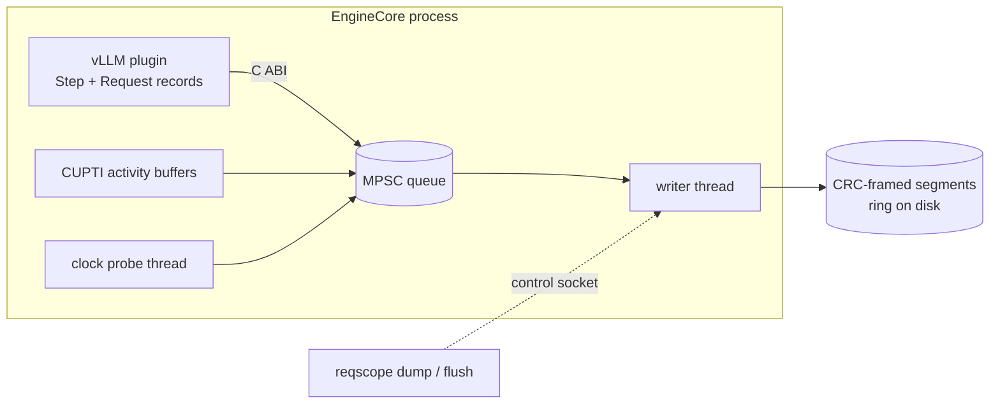

# Design

## Question

vLLM serves many requests in one batch, so one request's latency depends on
everything it shares steps with. When a request's tokens slow down, the
interesting question is *why*. Was the GPU busy with someone else's prefill?
Was the step's host work slow? Or was the request simply not scheduled?
Answering that needs three things joined on one timeline:

1. **Engine steps and their members:** which requests each step scheduled,
   with how many tokens and in which phase.
2. **GPU work:** every kernel, copy and memset, and which step launched it.
3. **Request lifecycles:** arrival, first scheduling, every token, finish.

Generic profilers capture (2) but know nothing about (1) or (3). Serving
metrics know (3) but not why. reqscope records all three with one clock and a
measured bound on how far GPU timestamps can be off.

## Recording



**The collector** (`collector/`, `libreqscope.so`) is loaded with
`CUDA_INJECTION64_PATH`, so it starts inside CUDA's own initialization,
before the application creates a context.
- It subscribes to CUPTI activity records and registers CLOCK_MONOTONIC as
  CUPTI's timestamp source.
- Records go through a bounded multi-producer queue to one writer thread.
  The writer appends them to CRC-framed segment files and keeps a
  time- and size-bounded ring on disk.
- A control socket (`/tmp/reqscope-PID.sock`) takes `flush`, `dump` (freeze
  the last N seconds into a new directory) and `status`.

Three modes:
- **plugin**: CUPTI is never started; only the vLLM plugin's steps,
  membership and request lifecycles are recorded, and the header has no GPU
  clock bound.
- **light**: one record per CUDA graph launch (graph envelope). Kernels
  launched outside a graph are not recorded one by one.
- **trace**: one record per kernel, including kernels inside graphs. Its
  per-kernel collection changes host timing under load (README, CUPTI-off
  comparison and open-loop overhead).

Both modes record only the driver and runtime APIs that submit work, move
data or synchronize, enabled one CUPTI callback ID at a time.

Torch and Triton surround every launch with query calls (`cudaGetDevice`,
`cuDevicePrimaryCtxGetState`, `cuPointerGetAttribute`). Recording those made
up most of trace mode's volume: in a capture of the README's experiment
with every API enabled, `cudaGetDevice` alone was half of 1.8M API records.
The single writer could not keep up, and CUPTI dropped 1.5M records in
22.7 s (`results/captures.json`, run `interference-s3`).

**The vLLM plugin** (`adapter/vllm`) is a `vllm.general_plugins` entry point.
It wraps:
- `GPUModelRunner.execute_model` and `sample_tokens`:
  - one **Step** record per engine step, with its members, phases and
    tokens;
  - CUPTI external correlation `CUSTOM0 = step_id` pushed around the step's
    launches, so every API call, and through its correlation id every
    kernel, carries the step id;
  - the step id written onto the `SchedulerOutput`.
- `Scheduler.add_request`, `schedule`, `update_from_output` and
  `_free_request`:
  - one **Request** record per request: arrival, first scheduled step,
    finish, and every token's time and producing step;
  - the producing step is read back from that `SchedulerOutput`;
  - a request's token log is flushed in 1,024-token `RequestTokens` chunks,
    so no record outgrows a queue slot.

The hooks need two details to be right:
- **Token time is recorded before vLLM processes the output.** vLLM frees a
  finished request inside `update_from_output`, so recording it afterwards
  lost every request's last token.
- **The producing step is recorded explicitly.** With async scheduling,
  step k+1 is already launched when step k's tokens are processed, so a
  timestamp cannot tell which step produced a token.

**Failure.** The profiler must not take serving down. If a collector call
fails (the writer hit a full disk, the collector is stopping, an NVTX range
cannot be opened), the plugin closes what it opened, stops collecting for
the rest of the process, records a `Diagnostic` if the collector still
accepts records, and warns; the engine step runs normally. A failed writer
also leaves `collector-error-PID.txt` in the output directory.

**Shutdown.** vLLM's shutdown SIGKILLs EngineCore almost immediately. A
capture is only complete if someone sends the collector `flush` first.
`bench/interference.py` does that for every collector in the server's
process tree.

## Clock bound

CUPTI stamps GPU activity in the collector's CLOCK_MONOTONIC domain, but
nothing says how wrong those stamps can be. A probe thread measures it:

```
every 500 ms:  t0 = now();  cuMemcpyHtoDAsync(4 bytes, private stream);
               cuStreamSynchronize();  t1 = now()
```

The copy's CUPTI `[start, end]` must lie inside `[t0, t1]`. The analyzer
pairs each `ClockProbe` record with that copy by time: a copy on the same
context and stream that lies at most 50 ms outside the bracket, matching
the closest pairs first so that a probe never takes its neighbour's copy.
It then takes the widest bracket plus any violation as the session's bound.
If any probe is unpaired, or the probe stopped (its setup or a copy failed,
which it reports in a `Diagnostic` with `stopped: true`), the bound stays
unknown. A probe that completed
after the last GPU record CUPTI delivered is counted as pending rather than
unpaired, since its copy may still have been in a CUPTI buffer. The probe
copies are excluded from application GPU time.

Two collector bugs kept the bound unknown in early runs:
- The probe bound the driver API with `dlsym(RTLD_DEFAULT)`. The CUDA runtime
  loads `libcuda` with `RTLD_LOCAL`, so the probe never started, and nothing
  said so. It now takes a handle to the loaded copy (`RTLD_NOLOAD`) and
  reports a `Diagnostic` record if it cannot run.
- The CUPTI device-buffer pool was capped at 4 buffers per context. At
  vLLM's launch rate CUPTI then delivered many records with zero timestamps:
  14% of kernels and most copies, probe copies included. The cap is gone.
  The analyzer treats a zero GPU timestamp as missing and counts such
  records.

## Analysis

`reqscope` (`analyzer/`, `cli/`) reads a capture with these joins:

```
GpuActivity --corr--> ApiCall --corr--> ExtCorr(step_id) --> Step --members--> Request
```

All ids are scoped by producer (boot id, pid, process start time). The
chain from GPU activity to request uses only these ids. Two joins do use
time: pairing clock probes with their copies (above), and `blame`'s
fallback for token logs without step ids (below). `analyze` and `explain`
split a timeline, so they also place scheduler and synchronization records
by time.

**`blame`** answers "why were this request's tokens slow":
1. Take the request's token times and the step that produced each token.
   If any chunk of the request's token log lacks `token_steps` (the plugin
   omits them from a chunk with a token of unknown step), fall back to the
   request's steps whose host span ended inside the gap. Under async
   scheduling that can be one step late, so the request's row says
   `producing_steps: host_span_in_gap` and the output carries a warning.
2. A gap more than 1.5× the request's median gap is slow. Its excess over
   the median is what needs explaining.
3. For the step that produced the token after the gap, report:
   - its GPU busy time (the union of its linked kernels and copies, measured
     in the GPU's own clock, so no cross-clock alignment is needed);
   - its co-scheduled members, with their phases and tokens.
4. Split the excess over the prefill tokens co-scheduled in that step. A
   slow gap with no co-scheduled prefill is reported as unexplained.
5. Rank culprits by the excess they caused across all requests.

`blame` also reports how far to trust the answer:
- how many GPU records it linked to steps, and how many had no timestamps;
- `trace`: Complete or Partial, with the reader's and analyzer's issues by
  reason (truncated or corrupt frames, sequence gaps, a missing end of
  session, a `collector-error-PID.txt` left by a failed writer), losses by
  reason, and the `Diagnostic` records of the collector and plugin;
- how many requests used the host-span fallback;
- `warnings`: one sentence for each of the above that limits the answer;
- the clock bound.

**`analyze` / `explain`** split each request's wall time into
`gpu_exec`, `gpu_idle_in_step`, `between_steps`, `between_steps_cpu` (with
scheduler evidence), `not_scheduled` and `residual`. GPU intervals are
used only when the clock bound is known and shorter than the interval.
`export-perfetto` writes a timeline.

The decomposition cuts a request's span at every start and end of the
intervals around it (its steps, its GPU activities, all GPU activity of its
process, scheduler states, losses, tokens). Each elementary piece is then
inside or outside every such interval, so one sweep over the pieces keeps
the intervals covering the current one. Tokens are matched to pieces by a
merge, and in-step gaps read per-process indexes of GPU busy time and
synchronization records.

## Format

A segment file starts with the 8 bytes `RQSSEG01`. Each frame is then a
little-endian `uint32 length`, a `uint32 crc32`, and `length` bytes of JSON.
- The first frame is a `Header`: producer identity, clock, mode, CUPTI
  version and the APIs enabled.
- Every other record has `type`, `producer` and a per-producer `seq`
  starting at 1. Gaps in `seq` are losses.

The collector reports its own losses as `Loss` records with a reason and a
count: CUPTI pool exhaustion, CUPTI drops, queue full, oversize records.

The reader verifies each frame's CRC. It fails loudly when a trace exceeds
its memory budget (`REQSCOPE_TRACE_BUDGET_MIB`); it never truncates silently.

## Limits

- One CUPTI subscriber (the V1 API): reqscope cannot run together with
  Nsight Systems or `torch.profiler`.
- The record layouts are those of CUPTI API 130202 (CUDA 13.2). Any other
  version is refused rather than parsed with the wrong layout.
- The vLLM plugin supports exactly vLLM 0.31.0 with the V2 model runner,
  the uni executor, TP=1 and PP=1.
- JSON records keep the format easy to inspect, at a cost in size (35 MB/s
  in trace mode under the overhead load) and in parse time (see the
  README's analysis-speed section). A binary encoding of the four record
  types that make up 99% of a trace is the next step.
- `analyze` and `explain` report every elementary piece of every request,
  so their output grows with the GPU activity around each request and is
  much larger than the capture. Long captures need `blame`, or a shorter
  window.
- The BPF scheduler probe (`bpf/`) needs CAP_BPF and was not part of these
  experiments.
