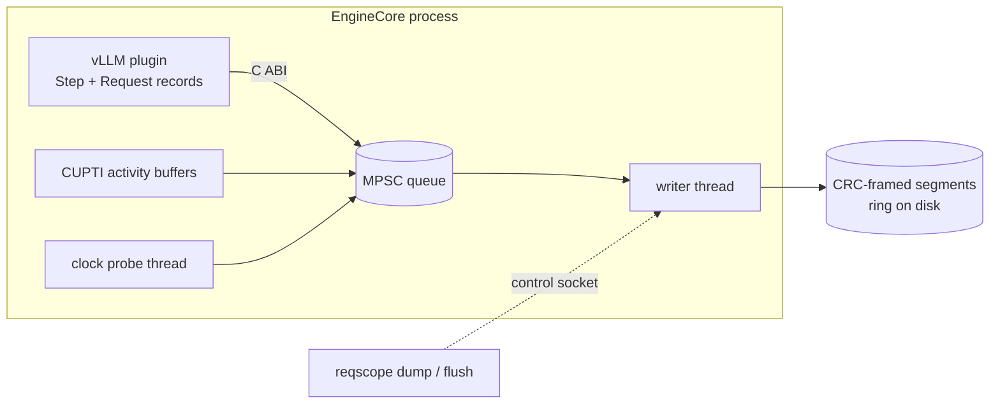

# Design

## Question

vLLM serves many requests in one batch, so one request's latency depends on
everything it shares steps with. When a request's tokens slow down, the
interesting question is *why*. Was the GPU busy with someone else's prefill?
Was the step's host work slow? Or was the request simply not scheduled?
Answering that needs three things joined on one timeline:

1. **Engine steps and their members:** which requests each step scheduled,
   with how many tokens and in which phase.
2. **GPU work:** every kernel, copy and memset, and which step launched it.
3. **Request lifecycles:** arrival, first scheduling, every token, finish.

Generic profilers capture (2) but know nothing about (1) or (3). Serving
metrics know (3) but not why. reqscope records all three with one clock and a
measured bound on how far GPU timestamps can be off.

## Recording



**The collector** (`collector/`, `libreqscope.so`) is loaded with
`CUDA_INJECTION64_PATH`, so it starts inside CUDA's own initialization,
before the application creates a context.
- It subscribes to CUPTI activity records and registers CLOCK_MONOTONIC as
  CUPTI's timestamp source.
- Records go through a bounded multi-producer queue to one writer thread.
  The writer appends them to CRC-framed segment files and keeps a
  time- and size-bounded ring on disk.
- A control socket (`/tmp/reqscope-PID.sock`) takes `flush`, `dump` (freeze
  the last N seconds into a new directory) and `status`.

Four modes:
- **plugin**: CUPTI is never started; only the vLLM plugin's steps,
  membership and request lifecycles are recorded, and the header has no GPU
  clock bound.
- **light**: one record per CUDA graph launch (graph envelope). Kernels
  launched outside a graph are not recorded one by one.
- **trace**: one record per kernel, including kernels inside graphs. Its
  per-kernel collection changes host timing under load (README, CUPTI-off
  comparison and open-loop overhead).
- **sampled**: light mode's records without graph envelopes, and one record
  per kernel on the steps it picks (below, "Sampled tracing").

The three CUPTI modes record only the driver and runtime APIs that submit
work, move data or synchronize, enabled one CUPTI callback ID at a time.

Torch and Triton surround every launch with query calls (`cudaGetDevice`,
`cuDevicePrimaryCtxGetState`, `cuPointerGetAttribute`). Recording those made
up most of trace mode's volume: in a capture of the README's experiment
with every API enabled, `cudaGetDevice` alone was half of 1.8M API records.
The single writer could not keep up, and CUPTI dropped 1.5M records in
22.7 s (`results/captures.json`, run `interference-s3`).

**What trace mode costs the engine.** Each capture carries the collector's
own accounting (`CollectorStats`: calls, time and longest call per site,
and which ran on an engine thread), and the benchmark samples every
EngineCore thread from `/proc`. One 40 s open-loop run per configuration
at 16 requests/s, read by `bench/trace_cost.py`
([results/trace-cost.json](../results/trace-cost.json)):
- **The collector's code on the engine thread is not the cost.** Buffer
  requests (64/s, under 0.3 µs), step push and pop (350/s each, under
  0.6 µs) and plugin records (190/s, 0.2 µs) add up to under 0.1% of a
  core. CUPTI never returned a buffer on an engine thread.
- **CUPTI's work inside each launch is,** and the collector cannot change
  it short of not tracing every kernel: the decode step's graph launch
  (about 400 kernel nodes) takes 277 µs in trace mode against 72 µs in
  light mode.
- **The writer was 0.33 cores,** 5.1 ms per 256 KB CUPTI buffer: 1.8 µs
  per record to frame it and most of the rest building Json objects. While
  it ran that way, 8% of kernel and copy launches (29,243 in 42 s) took
  over 100 µs, nearly all in runs of three or more consecutive launches of
  about 250 µs each: 7.2 s of launch time. The writer now formats each
  record as text (0.32 µs to frame, 0.10 cores in all) and those runs are
  gone (2,563 launches over 100 µs, 3 in runs; 4.4 s). Why the Json
  writer slowed launches on another thread is not established: slow
  launches overlapped the writer's busy intervals less often than other
  launches (15% against 40%), and CUPTI's own worker thread also fell from
  0.28 to 0.12 cores. The old writer allocated and freed several objects
  per record.
- **Graph launches over 1 ms** (27 in 42 s, median 1.44 ms, 1.3 s apart)
  come partly from CUPTI moving to its next device buffer: in
  `bench/launch_cost.py` the default 3.2 MB buffer gave 21 such stalls in
  5,000 steps and a 32 MB buffer 1 ([results/launch-cost.json](../results/launch-cost.json)).
  The collector now asks for 32 MB buffers, four allocated up front. In
  vLLM 15 remained in 42 s, so not all of them are buffer switches.
- **Not kept:** running the writer, the probe and CUPTI's worker on the
  host's efficiency cores (TPOT p50 5.51 ms against 5.36 ms unpinned, and
  8.4 s of slow launches against 4.4 s); a 1 ms CUPTI flush period (TPOT
  p99 14.3 ms, 150 stalls); pre-zeroed host buffers and a lower writer
  priority, which changed nothing in `bench/launch_cost.py`. 4 MB host
  buffers helped there only at a step rate the Json writer could not
  drain. The engine thread ran on an efficiency core in 1% of samples and
  waited for a CPU under 0.1% of the time, so CPU contention was not the
  cost on this host at its load during these runs (2–5).

**Sampled tracing.** Sampled mode (`REQSCOPE_MODE=sampled`) keeps light
mode's API and copy records for every step and turns CUPTI's kernel
records on only for some steps, so that per-kernel evidence costs about
what light mode costs:
- **Which steps.** One in `REQSCOPE_TRACE_EVERY`, and/or the next
  `REQSCOPE_TRACE_WINDOW` steps (default 32) after a step's start-to-start
  interval reaches `REQSCOPE_TRACE_TRIGGER_PERCENT` of the upper median of
  the last 64 such intervals (after 16 of them). With neither set, one step
  in 16. Only the interval of a step that, like the step before it, had no
  prefill counts: under async scheduling a step's interval also holds the
  wait for the previous step's output, and in the open-loop captures
  94–98% of the intervals of a step right after a prefill step reached 1.5
  times the median, against 4–9 of about 13,760 between decode-only steps
  ([results/sampled-captures.json](../results/sampled-captures.json)).
- **How.** The engine thread decides at the first push of each step id
  and switches kernel tracing on or off then (3.3–5.2 µs per switch on
  average); CUPTI decides at launch, so each step gets one granularity. A
  traced step gets a `TracedStep` record. Kernel tracing goes off one
  step late: the step after each run of traced steps (the guard step)
  launches with it on, gets no `TracedStep` record, and its node records
  are not used (next bullet). Graph envelopes are not recorded at all:
  once kernel tracing had been on, CUPTI gave vLLM's graph launches no
  graph records again.
- **Why the guard step.** When kernel tracing is off at a CUDA graph's
  next launch, CUPTI's records of the graph's last traced launch get the
  end times of later launches: each kernel's start is right, but its end
  is the same node's end in the last launch before tracing came back on
  or a forced flush read the records. On `fixtures/dag/sampled_replay.cu`
  (one graph of eight 100 µs kernels per step, one step in 4 traced)
  every traced kernel was recorded as 2.52 ms long, 12.2 ms at one in 16
  (`tests/test_sampled_replay.py` fails that way without the guard step).
  In vLLM, a traced decode step followed by an untraced one spanned
  17–20 ms at 1/4 and 54–68 ms at 1/16 from its first kernel's start to
  its last kernel's end, against 4.7–5.9 ms when the next step was traced
  too ([results/sampled-captures.json](../results/sampled-captures.json)).
  A traced launch in between leaves the earlier records alone, and the
  guard step's own records take the late ends instead (median span 12.8–
  15.2 ms at 1/4, 40–60 ms at 1/16). Why CUPTI does this was not looked
  into beyond these records. The guard step protects a traced step only
  when it launches the same graphs: in the round-1 open-loop captures, 119
  of 3,600 traced decode steps at 1/4 and 39 of 906 at 1/16 still spanned
  over 10 ms (up to 7.3 s), and in 115 and 36 of them the next step
  launched none of their graphs (110 and 32 had prefill)
  ([results/sampled-captures-guard.json](../results/sampled-captures-guard.json)).
  Each guard step costs a traced step's graph launch (209–254 µs against
  81–94 µs untraced, medians), so one in 4 now traces kernels on half the
  steps.
- **Flushing.** With kernel tracing switched at run time, CUPTI holds the
  engine's activity buffers until a forced flush, so the writer forces one
  every `REQSCOPE_CUPTI_FLUSH_MS` (200 ms) once three steps have been pushed
  since the last traced one, or after ten periods. A forced flush returns
  records of GPU work still running without timestamps: 2.3–3.4% of copy
  records in the captures summarized had none.
- **What blame does with it.** Only traced steps give GPU evidence and
  enter the comparable-step baselines ("Causes", below). The analyzer
  drops the node records of untraced steps (in practice the guard
  steps') right after reading a sampled capture; blame's `sampled_steps`
  counts them.

What it trades, from the multi-cause and open-loop runs of the README's
"Sampled trace mode" section. The sampled rows are from the second
session, with the guard step
([results/multicause-sampled-guard.json](../results/multicause-sampled-guard.json),
[results/openloop-sampled-guard.json](../results/openloop-sampled-guard.json));
trace and light mode were not rerun, so their rows are from the first
([results/multicause-sampled.json](../results/multicause-sampled.json),
[results/openloop-sampled.json](../results/openloop-sampled.json)), each
against no collector in its own session:

| Setting | Steps traced (kernel tracing on) | TPOT p50 / p99 vs none at 16 requests/s | GPU bursts found | Engine stops found |
|---|---|---|---|---|
| trace mode | all | +15.5% / +37.1% | 9 of 9 | 9 of 9 |
| one in 4 | 25% (50%) | +1.1% / +6.9% | 9 of 9 (26% of their slow steps) | 2 of 9 |
| one in 16 | 6.3% (12.5%) | +0.4% / +3.1% | 8 of 9 (5%) | 1 of 9 |
| trigger 150%, 32 steps | 5.4% (multi-cause), 0.8–7.0% (open loop) | +0.4% / +1.5% | 9 of 9 (90%) | 0 of 9 |
| light mode | none | +0.2% / +0.5% | not run | not run |

- **Engine stops are mostly lost.** A 200 ms stop makes one slow step.
  The trigger reacts to that step's interval and traces the steps after
  it, never the stopped one; periodic sampling traces a stopped step only
  by chance (3 of 18 at 1/4 and 1/16 with the guard step, 6 of 18
  before). With the guard step blame called all 3 host delay; before it,
  the late end times made it call all 6 GPU slowdown.
- **The guard step costs.** At 16 requests/s the TPOT p99 of every
  sampled arm lay above no collector's in every round, most for one in 4
  (6.17–7.14 ms against 6.05–6.08). The first session had 1/4 at +0.4% /
  +1.0%, but host load was higher and more varied in the second (2.4–13.1
  against 1.9–6.6), so how much of the difference is the guard step is
  not separated.

**The vLLM plugin** (`adapter/vllm`) is a `vllm.general_plugins` entry point.
It wraps:
- `GPUModelRunner.execute_model` and `sample_tokens`:
  - one **Step** record per engine step, with its members, phases and
    tokens;
  - CUPTI external correlation `CUSTOM0 = step_id` pushed around the step's
    launches, so every API call, and through its correlation id every
    kernel, carries the step id;
  - the step id written onto the `SchedulerOutput`.
- `Scheduler.add_request`, `schedule`, `update_from_output` and
  `_free_request`:
  - one **Request** record per request: arrival, first scheduled step,
    finish, and every token's time and producing step;
  - the producing step is read back from that `SchedulerOutput`;
  - a request's token log is flushed in 1,024-token `RequestTokens` chunks,
    so no record outgrows a queue slot.

The hooks need two details to be right:
- **Token time is recorded before vLLM processes the output.** vLLM frees a
  finished request inside `update_from_output`, so recording it afterwards
  lost every request's last token.
- **The producing step is recorded explicitly.** With async scheduling,
  step k+1 is already launched when step k's tokens are processed, so a
  timestamp cannot tell which step produced a token.

**Failure.** The profiler must not take serving down. If a collector call
fails (the writer hit a full disk, the collector is stopping, an NVTX range
cannot be opened), the plugin closes what it opened, stops collecting for
the rest of the process, records a `Diagnostic` if the collector still
accepts records, and warns; the engine step runs normally. A failed writer
also leaves `collector-error-PID.txt` in the output directory.

**Shutdown.** vLLM's shutdown SIGKILLs EngineCore almost immediately. A
capture is only complete if someone sends the collector `flush` first.
`bench/interference.py` does that for every collector in the server's
process tree.

## Clock bound

CUPTI stamps GPU activity in the collector's CLOCK_MONOTONIC domain, but
nothing says how wrong those stamps can be. A probe thread measures it:

```
every 500 ms:  t0 = now();  cuMemcpyHtoDAsync(4 bytes, private stream);
               cuStreamSynchronize();  t1 = now()
```

The copy's CUPTI `[start, end]` must lie inside `[t0, t1]`. The analyzer
pairs each `ClockProbe` record with that copy by time: a copy on the same
context and stream that lies at most 50 ms outside the bracket, matching
the closest pairs first so that a probe never takes its neighbour's copy.
It then takes the widest bracket plus any violation as the session's bound.
If any probe is unpaired, or the probe stopped (its setup or a copy failed,
which it reports in a `Diagnostic` with `stopped: true`), the bound stays
unknown. A probe that completed
after the last GPU record CUPTI delivered is counted as pending rather than
unpaired, since its copy may still have been in a CUPTI buffer. The probe
copies are excluded from application GPU time.

Two collector bugs kept the bound unknown in early runs:
- The probe bound the driver API with `dlsym(RTLD_DEFAULT)`. The CUDA runtime
  loads `libcuda` with `RTLD_LOCAL`, so the probe never started, and nothing
  said so. It now takes a handle to the loaded copy (`RTLD_NOLOAD`) and
  reports a `Diagnostic` record if it cannot run.
- The CUPTI device-buffer pool was capped at 4 buffers per context. At
  vLLM's launch rate CUPTI then delivered many records with zero timestamps:
  14% of kernels and most copies, probe copies included. The cap is gone.
  The analyzer treats a zero GPU timestamp as missing and counts such
  records.

## Analysis

`reqscope` (`analyzer/`, `cli/`) reads a capture with these joins:

```
GpuActivity --corr--> ApiCall --corr--> ExtCorr(step_id) --> Step --members--> Request
```

All ids are scoped by producer (boot id, pid, process start time). The
chain from GPU activity to request uses only these ids. Two joins do use
time: pairing clock probes with their copies (above), and `blame`'s
fallback for token logs without step ids (below). `analyze` and `explain`
split a timeline, so they also place scheduler and synchronization records
by time.

**`blame`** answers "why were this request's tokens slow":
1. Take the request's token times and the step that produced each token.
   If any chunk of the request's token log lacks `token_steps` (the plugin
   omits them from a chunk with a token of unknown step), fall back to the
   request's steps whose host span ended inside the gap. Under async
   scheduling that can be one step late, so the request's row says
   `producing_steps: host_span_in_gap` and the output carries a warning.
2. A gap more than 1.5× the request's median gap is slow. Its excess over
   the median is what needs explaining.
3. For the step that produced the token after the gap, report:
   - its GPU busy time (the union of its linked kernels and copies, measured
     in the GPU's own clock, so no cross-clock alignment is needed);
   - its co-scheduled members, with their phases and tokens.
4. Split the excess over the prefill tokens co-scheduled in that step. A
   slow gap with no co-scheduled prefill is reported as unexplained.
5. Rank culprits by the excess they caused across all requests.

`blame` also reports how far to trust the answer:
- how many GPU records it linked to steps, and how many had no timestamps;
- `trace`: Complete or Partial, with the reader's and analyzer's issues by
  reason (truncated or corrupt frames, sequence gaps, a missing end of
  session, a `collector-error-PID.txt` left by a failed writer), losses by
  reason, and the `Diagnostic` records of the collector and plugin;
- how many requests used the host-span fallback;
- `warnings`: one sentence for each of the above that limits the answer;
- the clock bound.

### Causes

Each slow gap also gets a `cause`, from its producing step and the gap
`[begin, end]`, with the numbers behind it in `cause_evidence`. The rules
are applied in order; "excess" is the gap minus the request's median gap.

1. **interference**: at least 128 prefill tokens of other requests were
   co-scheduled in the producing step.
2. **undetermined**: the producing step has no GPU records (plugin-only
   capture, or no linked GPU work), or the capture is sampled and the step
   has no `TracedStep` record. Without GPU time, GPU slowness and host
   delay both look like a long gap. In a sampled capture only traced steps
   enter the baselines below, and each slow gap's step says whether it was
   traced (`traced`); `blame`'s summary counts traced steps
   (`sampled_steps`).
3. Otherwise two components are measured against baselines:
   - **GPU extra**: how much the step's GPU busy time, its GPU wait inside
     the step, and its launch wait exceed the medians of comparable steps.
     Comparable steps have the same producer, member count and scheduled
     tokens, no prefill, and step ids within 200 of this one (local,
     because decode GPU work grows with context length). The GPU wait
     inside the step is idle time between the step's own GPU intervals
     while its next kernel had already been launched; the launch wait is
     the shortest time from a launch API's return to its kernel's start.
     Both grow when the GPU is running another process's work. At least 5
     comparable steps are needed, or GPU extra is 0.
   - **host extra**: how much the gap's host time exceeds the request's
     median over all its gaps. Host time is idle time inside the step while
     its next kernel had not been launched yet, time after the step's GPU
     work finished until the token was processed, and time from the gap's
     start until the step's first launch returned.
4. **gpu_slowdown** if GPU extra is at least host extra and at least half
   the excess; **host_delay** if host extra is larger and at least half the
   excess; **unexplained** otherwise. The GPU terms can overlap (a slower
   previous step also lengthens this step's launch wait), so GPU extra can
   exceed the excess; the components are compared, not added up to the gap.

A host delay can be the profiler's own. When the capture records the
writer's busy intervals (`CollectorActivity`), each slow gap's evidence has
`collector_active_ns`, the time inside the gap when the writer was busy or
the clock probe was bracketing a copy, and a host-delay verdict gets the
flag `collector_active` when that time is at least half its host extra.
The flag says the collector was busy for as long as the delay, not that it
caused it. `blame`'s summary counts flagged host delays
(`host_delay_gaps_with_collector_active`).

The rules do not separate a host-device synchronization stall from other
host delay: both appear as host time around the step's GPU work. A long
copy on the step's own streams counts as GPU work of the step.

**`analyze` / `explain`** split each request's wall time into
`gpu_exec`, `gpu_idle_in_step`, `between_steps`, `between_steps_cpu` (with
scheduler evidence), `not_scheduled` and `residual`. GPU intervals are
used only when the clock bound is known and shorter than the interval.
`export-perfetto` writes a timeline.

The decomposition cuts a request's span at every start and end of the
intervals around it (its steps, its GPU activities, all GPU activity of its
process, scheduler states, losses, tokens). Each elementary piece is then
inside or outside every such interval, so one sweep over the pieces keeps
the intervals covering the current one. Tokens are matched to pieces by a
merge, and in-step gaps read per-process indexes of GPU busy time and
synchronization records.

## Format

A segment file starts with the 8 bytes `RQSSEG01`. Each frame is then a
little-endian `uint32 length`, a `uint32 crc32`, and `length` bytes of JSON.
- The first frame is a `Header`: producer identity, clock, mode, CUPTI
  version and the APIs enabled.
- Every other record has `type`, `producer` and a per-producer `seq`
  starting at 1. Gaps in `seq` are losses.

The collector reports its own losses as `Loss` records with a reason and a
count: CUPTI pool exhaustion, CUPTI drops, queue full, oversize records.

The reader verifies each frame's CRC. It fails loudly when a trace exceeds
its memory budget (`REQSCOPE_TRACE_BUDGET_MIB`); it never truncates silently.

## Limits

- One CUPTI subscriber (the V1 API): light and trace mode cannot run
  together with Nsight Systems or `torch.profiler`; plugin-only mode can.
- The record layouts are those of CUPTI API 130202 (CUDA 13.2). Any other
  version is refused rather than parsed with the wrong layout.
- The vLLM plugin supports exactly vLLM 0.31.0 with the V2 model runner,
  the uni executor, TP=1 and PP=1.
- JSON records keep the format easy to inspect, at a cost in size (35 MB/s
  in trace mode under the overhead load) and in parse time (see the
  README's analysis-speed section). A binary encoding of the four record
  types that make up 99% of a trace is the next step.
- `analyze` and `explain` report every elementary piece of every request,
  so their output grows with the GPU activity around each request and is
  much larger than the capture. Long captures need `blame`, or a shorter
  window.
